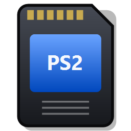

# PSMemoMan – PS1 / PS2 Memory Card Manager

Windows-Programm (eine einzelne EXE) zum Verwalten von PlayStation- und PlayStation-2-Memory-Cards
für Emulatoren, PS3, PSP/Vita, OPL und Hardware-Adapter. Bis zu vier Karten gleichzeitig in einem Fenster,
animierte Savegame-Icons, Drag & Drop und nicht-destruktives Speichern mit automatischen Backups.



## Funktionen

- **Bis zu 4 Karten** nebeneinander; Segmente erscheinen nur für geladene Karten und lassen sich einzeln schließen.
- **Animierte Icons**: PS2-3D-Icons (Morph-Animation, Textur, Beleuchtung) per Software-Renderer, PS1-Icons (1–3 Frames).
- **Alle Regionen** (PAL, NTSC-U, NTSC-J, Korea, Asien), Shift-JIS-Titel.
- **Drag & Drop**: Karte ↔ Karte (kopieren, mit Umschalt verschieben), Explorer → Karte (Import), Karte → Explorer (Export),
  Kartendateien ins Fenster ziehen (öffnen).
- **Neue Karten** für PS1 und PS2 in allen unten genannten Formaten, **Speichern unter** konvertiert zwischen Formaten.
- **Sicherheit**: Änderungen nur im Speicher bis „Speichern“; neues Abbild wird verifiziert, in eine Temp-Datei geschrieben,
  zurückgelesen und erst dann ersetzt; die alte Datei landet vorher im Ordner `Backups`. Exporte überschreiben nie.

### Kartenformate

| System | Format | Lesen | Schreiben / Neu |
|---|---|---|---|
| PS2 | PCSX2 / LRPS2 `.ps2` (8–64 MB, ECC) | ✔ | ✔ |
| PS2 | PCSX2-Ordnerkarten (`_pcsx2_superblock`) | ✔ | ✔ |
| PS2 | PS3 `.VM2`, OPL `.vmc`, MemCard PRO2 / SD2PSX `.mc2`, `.bin` | ✔ | ✔ |
| PS1 | `.mcr` `.mcd` `.mc` `.srm` (ePSXe, DuckStation, Beetle PSX, SwanStation, PCSX2 …) | ✔ | ✔ |
| PS1 | PS3 `.VM1`, DexDrive `.gme`, VGS/Bleem `.vgs`/`.mem`, POPStarter `.VMC` | ✔ | ✔ |
| PS1 | PSP / PS Vita `.VMP` (signiert) | ✔ | ✔ (Signatur wird neu berechnet) |

### Savegame-Formate

- **PS2**: PSU, MAX (Action Replay, LZARI), CBS (CodeBreaker), SPS/XPS (SharkPort/X-Port, nur Import),
  PSV (PS3, signiert), ZIP, Save-Ordner
- **PS1**: MCS, PSX/MCB/MCX/PDA (Action Replay/GameShark/Xploder), RAW, PSV (PS3, signiert)

## Bauen

Voraussetzung: .NET 9 SDK (Windows).

```
cd src
dotnet publish -c Release -r win-x64 --self-contained true -p:PublishSingleFile=true -p:EnableCompressionInSingleFile=true -p:IncludeNativeLibrariesForSelfExtract=true -p:DebugType=none -o ../publish
```

Tests der Kernbibliothek (benötigt eigene Testkarten/-saves in einem Ordner):

```
cd tests/CoreTest
dotnet run -c Release -- <testordner> <ausgabeordner>
```

## Danksagung / Quellen

- **mymc** von Ross Ridge (Public Domain) und die Dart-Portierung **dart_mymc** (BAD-AL) – PS2-Dateisystem, ECC, Save-Formate
- **MemcardRex** von Shendo (GPL-3) – PS1-Containerformate, VMP/PSV-Signaturverfahren
- **LZARI** von Haruhiko Okumura
- PlayStation ist eine Marke von Sony Interactive Entertainment; dieses Projekt steht in keiner Verbindung zu Sony.

## Lizenz

GNU General Public License v3.0 – siehe [LICENSE](LICENSE).
