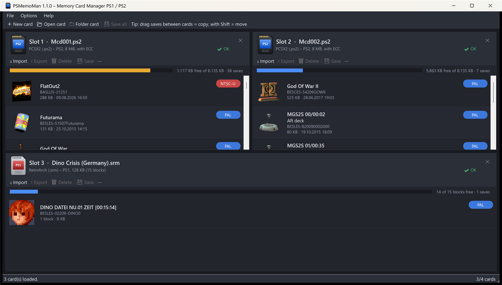

# PSMemoMan – PS1 / PS2 Memory Card Manager

A Windows memory card manager for **PlayStation** and **PlayStation 2** – a single portable EXE, no installation.
Up to four memory cards side by side in one window, animated save icons, drag & drop everywhere,
non-destructive saving with automatic backups, card health check, repair and rescue tools.
User interface in **English and German**.



## Features

- **Up to 4 cards at once** – a panel only appears for each loaded card; panels can be closed individually.
- **Animated icons** – PS2 3D icons (morph animation, texture, lighting) rendered by a built-in software rasterizer,
  PS1 icons (1–3 frames).
- **All regions** – PAL, NTSC-U, NTSC-J, Korea, Asia; Shift-JIS titles are decoded correctly.
- **Drag & drop** – card ↔ card (copy, hold <kbd>Shift</kbd> to move), Explorer → card (import),
  card → Explorer (export), drop card files into the window to open them.
- **Create new cards** for PS1 and PS2 in all formats listed below; **Save as** converts between formats
  (e.g. PCSX2 `.ps2` ⇄ PS3 `.VM2` ⇄ OPL `.vmc`, PS1 `.mcr` ⇄ `.gme` ⇄ `.VM1` ⇄ PSP/Vita `.VMP`).
- **Rename / change region** of a save (product code, files named like the save directory are renamed too).
- **Signed formats** – PSP/Vita `.VMP` cards and PS3 `.PSV` saves are signed correctly when written
  (verified against genuine, Sony-signed VMP files).
- **Health check & repair** – status badge per card (✔ / ⚠ / ✖) and a check dialog:
  - PS2: broken and cross-linked cluster chains, lost clusters (can be freed), correctable ECC bit errors
    (can be written back), uncorrectable ECC errors. Damaged saves are rescued as far as possible instead of hidden.
    Deleting a damaged save never frees clusters still used by another save.
  - PS1: directory checksums, card header, orphaned / invalid blocks, broken block chains,
    **undelete** of deleted saves whose blocks are still intact.
  - Restore any backup made by the program; unformatted card images are detected and can be formatted.
- **Rescue import (no guarantee)** – damaged or truncated save files (PSU, MAX, CBS, SPS/XPS, PSV, MCS, PSX …)
  that other tools reject can still be imported: everything readable is kept, missing parts are zero-filled,
  and the save is clearly flagged.
- **Safety first** – all changes happen in memory until you click *Save*. The new image is verified, written to a
  temporary file, read back and compared, the old file is copied to `Backups\`, and only then replaced.
  Exports never overwrite existing files. Folder-card deletions are moved to the backup folder.

### Memory card formats

| System | Format | Read | Write / New |
|---|---|:-:|:-:|
| PS2 | PCSX2 / LRPS2 `.ps2` (8–64 MB, with ECC) | ✔ | ✔ |
| PS2 | PCSX2 folder memory cards (`_pcsx2_superblock`) | ✔ | ✔ |
| PS2 | PS3 `.VM2`, OPL `.vmc`, MemCard PRO2 / SD2PSX `.mc2`, raw `.bin` (with/without ECC) | ✔ | ✔ |
| PS1 | raw `.mcr` `.mcd` `.mc` `.srm` (ePSXe, DuckStation, Beetle PSX, SwanStation, PCSX2 …) | ✔ | ✔ |
| PS1 | PS3 `.VM1`, DexDrive `.gme`, VGS/Bleem `.vgs`/`.mem`, POPStarter `.VMC` | ✔ | ✔ |
| PS1 | PSP / PS Vita `.VMP` (signed) | ✔ | ✔ |

Formats are detected by content, not by file extension.

### Save formats

| | Import | Export |
|---|---|---|
| PS2 | PSU, MAX (Action Replay Max), CBS (CodeBreaker), SPS/XPS (SharkPort/X-Port), PSV (PS3), ZIP, folders, whole cards | PSU, MAX, CBS, PSV (signed), folder, ZIP |
| PS1 | MCS, PSX/MCB/MCX/PDA (Action Replay/GameShark/Xploder), RAW, PSV (PS3), whole cards | MCS, PSX, RAW, PSV (signed) |

## Usage tips

- **PSP:** copy the card to `ms0:/PSP/SAVEDATA/<TITLE-ID>/SCEVMC0.VMP` (slot 2: `SCEVMC1.VMP`).
  **PS Vita** (HENkaku/Enso + VitaShell): `ux0:/pspemu/PSP/SAVEDATA/<TITLE-ID>/`.
- **PS3:** PSV files go to `PS3/EXPORT/PSV/` on a USB drive; exported names follow the PS3 scheme
  (e.g. `BESLES-537036B6B.PSV`).
- **RetroArch:** Beetle PSX / SwanStation use raw 128 KB cards (`.srm`, `<game>.1.mcr`), LRPS2 uses PCSX2 `.ps2` cards.
  Close the core before editing – RetroArch writes its cards on exit.
- Eject the card in PCSX2 (or close the emulator) before saving changes.
- A game only finds saves with its own product code (e.g. `BESLES-…` = PAL, `BASLUS-…` = USA). Saves from another
  region can sometimes be used after renaming them – no guarantee.

## Download

**[Latest release](https://github.com/frankyfife/psmemoman/releases/latest)** – download `PSMemoMan-<version>-win-x64.zip`,
unzip anywhere and run `MemcardManager.exe` (Windows 10/11 x64, no installation, .NET runtime included).
Windows SmartScreen may warn because the EXE is not code-signed – choose *More info → Run anyway*.

## Build

Build it yourself with the .NET 9 SDK on Windows:

```
cd src
dotnet publish -c Release -r win-x64 --self-contained true -p:PublishSingleFile=true -p:EnableCompressionInSingleFile=true -p:IncludeNativeLibrariesForSelfExtract=true -p:DebugType=none -o ../publish
```

The result is a single `MemcardManager.exe` (≈ 48 MB, includes the .NET runtime). Settings and the `Backups` folder
are stored next to the EXE.

Core tests (need your own test cards/saves in a folder):

```
cd tests/CoreTest
dotnet run -c Release -- <test-folder> <output-folder>
```

## Credits

- **mymc** by Ross Ridge (public domain) and its Dart port **dart_mymc** (BAD-AL) – PS2 file system, ECC, save formats
- **MemcardRex** by Shendo (GPL-3) – PS1 container formats, VMP/PSV signature algorithm
- **LZARI** by Haruhiko Okumura
- PlayStation is a trademark of Sony Interactive Entertainment. This project is not affiliated with Sony.

## Author

**frankyfife** – https://github.com/frankyfife/psmemoman

## License

GNU General Public License v3.0 – see [LICENSE](LICENSE).
